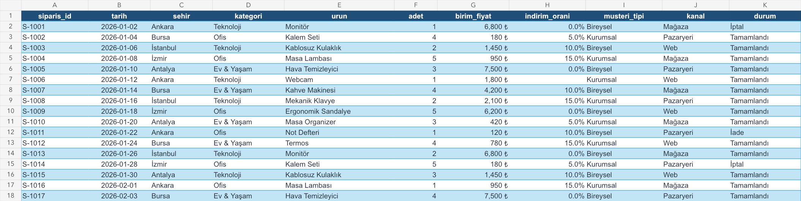

# KNIME ile Mini Satış Analizi

Bu proje, KNIME Analytics Platform'u sıfırdan öğrenirken hazırladığımız uçtan uca bir satış analizi çalışmasıdır. Sentetik bir Excel veri setini okuyup veri kalitesi sorunlarını düzeltiyor, yalnızca tamamlanan siparişleri seçiyor, net satış tutarını hesaplıyor, kategori bazında özetliyor ve sonucu hem grafik hem de Excel dosyası olarak üretiyoruz.

> Veri seti tamamen sentetiktir ve yalnızca eğitim amacıyla hazırlanmıştır.

## Proje sonucu

| Kategori | Net satış (TL) |
| --- | ---: |
| Ev & Yaşam | 147.663 |
| Teknoloji | 117.690 |
| Ofis | 70.629 |
| **Toplam** | **335.982** |

Analiz sonunda 49 ham satırdan 1 yinelenen sipariş kaldırıldı; yalnızca `Tamamlandı` durumundaki 40 sipariş analiz edildi.

## Workflow

```text
Excel Reader
  -> Missing Value
  -> Duplicate Row Filter
  -> Row Filter
  -> Math Formula
  -> GroupBy
       |-> Bar Chart
       `-> Excel Writer
```



## Adım adım yaptıklarımız

### 1. Excel verisini okuduk

`Excel Reader` ile `outputs/knime-baslangic/mini_satislar.xlsx` dosyasını okuduk.

- Çalışma sayfası: `Siparisler`
- Başlangıç: **49 satır, 11 sütun**

### 2. Eksik indirim oranlarını doldurduk

`Missing Value` node'unda:

- Sütun: `indirim_orani`
- İşlem: `Fix Value`
- Değer: `0`

Bu adım satır silmeden boş indirimleri sıfıra çevirdi. Sonuç: **49 satır**.

### 3. Yinelenen siparişi kaldırdık

`Duplicate Row Filter` node'unda tekrar kontrolü için yalnızca `siparis_id` sütununu kullandık ve ilk kaydı koruduk.

Sonuç: **48 benzersiz sipariş**.

### 4. Tamamlanan siparişleri seçtik

`Row Filter` node'unda:

- Sütun: `durum`
- Operatör: `Equals`
- Değer: `Tamamlandı`

Sonuç: **40 tamamlanan sipariş**.

### 5. Net satış tutarını hesapladık

`Math Formula` node'unda `net_tutar` adında yeni bir sütun oluşturduk:

```text
$adet$ * $birim_fiyat$ * (1 - $indirim_orani$)
```

Sonuç: **40 satır, 12 sütun**.

### 6. Kategori bazında özetledik

`GroupBy` node'unda:

- Group column: `kategori`
- Manual Aggregation: `net_tutar` -> `Sum`

Sonuç: **3 kategori, 2 sütun**.

### 7. Grafiği oluşturduk

`Bar Chart` node'unda:

- Category dimension: `kategori`
- Frequency dimension: `Sum(net_tutar)`
- Aggregation: `None` — toplamlar GroupBy adımında zaten hesaplandı.

Grafik, en yüksek net satışın `Ev & Yaşam` kategorisinde olduğunu gösterdi.

### 8. Sonucu Excel'e yazdık

`Excel Writer` node'unu `GroupBy` çıkışına ayrı bir dal olarak bağladık.

- Çıktı: `outputs/knime-baslangic/kategori_satis_ozeti.xlsx`
- Sayfa adı: `Kategori_Ozeti`
- Dosya varsa: `Overwrite`

## Kontrol noktaları

| Node | Beklenen çıktı |
| --- | --- |
| Excel Reader | 49 satır, 11 sütun |
| Missing Value | 49 satır, 11 sütun |
| Duplicate Row Filter | 48 satır, 11 sütun |
| Row Filter | 40 satır, 11 sütun |
| Math Formula | 40 satır, 12 sütun |
| GroupBy | 3 satır, 2 sütun |

## Proje yapısı

```text
.
├── README.md
├── outputs/
│   └── knime-baslangic/
│       ├── mini_satislar.xlsx
│       ├── kategori_satis_ozeti.xlsx
│       └── previews/
├── scripts/
│   └── build_starter_dataset.mjs
└── workflow/
    └── Mini_Satis_Analizi/
```

## Çalıştırma

1. Bu repoyu klonla veya ZIP olarak indir.
2. KNIME Analytics Platform 5.12 veya uyumlu bir sürümü aç.
3. `workflow/Mini_Satis_Analizi` klasöründeki workflow'u KNIME'a aktar.
4. `Excel Reader` ayarlarında giriş dosyasını kendi bilgisayarındaki `outputs/knime-baslangic/mini_satislar.xlsx` dosyasına yönlendir.
5. `Excel Writer` ayarlarında çıktı konumunu kendi proje klasörüne göre güncelle.
6. Workflow'u baştan sona çalıştır ve yukarıdaki kontrol noktalarını doğrula.

KNIME ayarları yerel dosya yollarını saklayabildiği için, farklı bir bilgisayarda ilk çalıştırmada giriş ve çıkış yollarını yeniden seçmek gerekebilir.

## Veri seti

`mini_satislar.xlsx` iki sayfa içerir:

- `Siparisler`: Analizde kullanılan ham satış verileri
- `Veri_Sozlugu`: Sütun açıklamaları ve veri tipleri

Veri setine eğitim amacıyla bilinçli olarak:

- 4 boş `indirim_orani` değeri,
- 1 yinelenen sipariş satırı

eklenmiştir.



## Bu projede öğrendiklerimiz

- KNIME workflow ve node mantığı
- Node ekleme, bağlama, yapılandırma ve çalıştırma
- Excel okuma ve yazma
- Eksik değer yönetimi
- Yinelenen kayıt temizliği
- Satır filtreleme
- Formülle yeni sütun üretme
- GroupBy ile toplulaştırma
- Bar Chart ile görselleştirme
- Tek bir node çıktısını birden fazla dala bağlama

## Sonraki geliştirmeler

- Şehir bazında net satış analizi
- Satış kanalı ve müşteri tipi karşılaştırması
- Tarih sütununu dönüştürerek aylık satış trendi
- Etkileşimli KNIME dashboard'u

## Kaynaklar

- [KNIME Analytics Platform dokümantasyonu](https://docs.knime.com/ap/latest/)
- [KNIME kullanıcı rehberi](https://docs.knime.com/ap/latest/analytics_platform_user_guide/)
- [İlk KNIME workflow'u](https://docs.knime.com/get-started/first-workflow)
